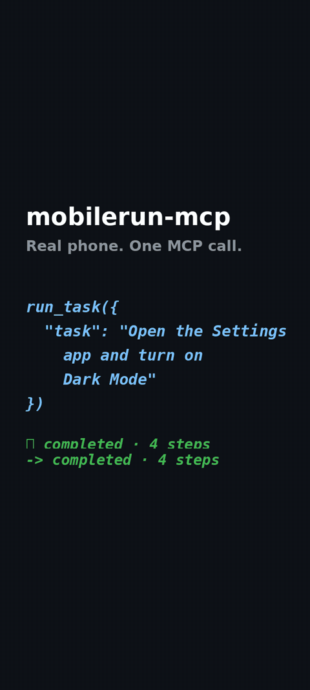

<picture align="center">
  <source media="(prefers-color-scheme: dark)" srcset="./assets/mobilerun-dark.png">
  <source media="(prefers-color-scheme: light)" srcset="./assets/mobilerun.png">
  
</picture>

<h3 align="center">MCP Server</h3>

<p align="center">
  <strong>Give your AI agent control of Android devices with the Mobilerun MCP server.</strong><br>
  Control devices, run agent tasks, manage apps, and build workflows on Mobilerun Cloud from any MCP client.
</p>

<div align="center">

<a href="https://docs.mobilerun.ai/mcp-server">📕 Documentation</a> · <a href="https://cloud.mobilerun.ai">☁️ Mobilerun Cloud</a> · <a href="https://github.com/droidrun/mobilerun">🤖 Mobilerun framework</a> · <a href="https://discord.gg/ZZbKEZZkwK">💬 Discord</a>

[](https://github.com/droidrun/mobilerun-mcp) [](./LICENSE) [](https://mobilerun.ai) [](https://x.com/mobilerun_ai) [](https://discord.gg/ZZbKEZZkwK)

[](https://cursor.com/en/install-mcp?name=mobilerun&config=eyJ1cmwiOiJodHRwczovL2Nsb3VkLm1vYmlsZXJ1bi5haS9hcGkvbWNwIn0=) [](https://insiders.vscode.dev/redirect/mcp/install?name=mobilerun&config=%7B%22type%22%3A%22http%22%2C%22url%22%3A%22https%3A%2F%2Fcloud.mobilerun.ai%2Fapi%2Fmcp%22%7D) [](https://insiders.vscode.dev/redirect/mcp/install?name=mobilerun&config=%7B%22type%22%3A%22http%22%2C%22url%22%3A%22https%3A%2F%2Fcloud.mobilerun.ai%2Fapi%2Fmcp%22%7D&quality=insiders)

</div>

<p align="center">
  
</p>

- 📱 List, create, and manage Android devices
- 📸 Inspect screenshots and UI state; tap, swipe, and type
- 🤖 Run agent tasks and chat with the Mobilerun Assistant
- 📦 Manage apps, device files, and settings
- 🔀 Build workflows with actions, triggers, and webhooks
- 🔑 Sign in with OAuth — no API key to copy, nothing to install for the hosted endpoint
- 🛠️ Open source and self-hostable

## 🚀 Quickstart

Connect to **`https://cloud.mobilerun.ai/api/mcp`**. Your first connection opens browser sign-in with your Mobilerun account (OAuth 2.1 + PKCE with dynamic client registration). No API key needed.

### Claude Code

```bash
claude mcp add --transport http mobilerun https://cloud.mobilerun.ai/api/mcp
```

Run `/mcp` inside Claude Code to sign in.

### Codex CLI

```bash
codex mcp add mobilerun --url https://cloud.mobilerun.ai/api/mcp
codex mcp login mobilerun
```

### Cursor / VS Code

Click the install badge above and sign in when prompted. For manual Cursor setup, use the `mcpServers` JSON under **Any other MCP client** below.

<details>
<summary>VS Code JSON fallback (.vscode/mcp.json)</summary>

```json
{
  "servers": {
    "mobilerun": {
      "type": "http",
      "url": "https://cloud.mobilerun.ai/api/mcp"
    }
  }
}
```

</details>

### Claude Desktop / claude.ai

Add a custom connector with this URL, then sign in:

```text
https://cloud.mobilerun.ai/api/mcp
```

### Any other MCP client

Add a remote HTTP server using your client's settings. For clients using `mcpServers` (including Cursor):

```json
{
  "mcpServers": {
    "mobilerun": {
      "url": "https://cloud.mobilerun.ai/api/mcp"
    }
  }
}
```

## 💬 Try it

- “List my Mobilerun devices.”
- “Open Settings on my device and turn on dark mode.”
- “Take a screenshot of my device and describe what's on screen.”
- “Ask the Mobilerun assistant which of my devices are ready.”

## 🧰 Tools

The available tools and operations depend on the server's policy and your account permissions.

| Family | Tools | What it does |
| --- | --- | --- |
| Devices | `list_devices`, `get_device`, `get_device_screenshot`, `get_device_ui_state`, `list_apps_on_device`, `create_device`, `terminate_device` | Inspect, create, and terminate devices |
| Device control | `manage_device`, `device_action`, `manage_device_apps`, `manage_device_files`, `configure_device`, `manage_esim` | Control input, apps, files, settings, and eSIMs |
| Tasks | `run_task`, `get_task`, `list_tasks`, `stop_task`, `send_task_message`, `get_task_media` | Run, monitor, message, and stop agent tasks |
| Workflows | `list_workflow_resources`, `get_workflow_resource`, `create_action`, `create_trigger`, `create_flow`, `manage_flow`, `workflow_events` | Build and manage actions, triggers, flows, and events |
| Webhooks | `webhooks` | Manage subscriptions and deliveries |
| Credentials | `list_credentials`, `list_credential_packages`, `manage_credentials` | Access and manage stored credentials |
| Apps | `apps` | Browse and manage applications |
| Proxies | `proxies`, `connect` | Manage proxies and purchase connectivity |
| Numbers & messages | `numbers`, `messages` | Manage numbers and SMS conversations |
| Mailboxes | `mailboxes` | Manage mailboxes, inbox links, and email |
| Files | `files` | Manage organization files and signed transfer URLs |
| Platform | `platform_catalog` | Browse device models, timezones, and app event types |
| Assistant | `assistant` | Chat with the Mobilerun Assistant |

Some tools create billed resources (for example `create_device`, proxy purchases, or work the assistant does for you). Charges apply to the signed-in account. Only approve an assistant permission after the user explicitly confirms it.

## 🔑 API key (CI and headless)

For clients that cannot use OAuth, connect to **`https://api.mobilerun.ai/v1/mcp`** with an `Authorization: Bearer dr_sk_...` header. Create a key in [Mobilerun Cloud](https://cloud.mobilerun.ai); see [API keys](https://docs.mobilerun.ai/api-keys).

```json
{
  "mcpServers": {
    "mobilerun": {
      "url": "https://api.mobilerun.ai/v1/mcp",
      "headers": {
        "Authorization": "Bearer dr_sk_YOUR_KEY"
      }
    }
  }
}
```

```bash
claude mcp add --transport http mobilerun https://api.mobilerun.ai/v1/mcp --header "Authorization: Bearer dr_sk_YOUR_KEY"
```

## 🛠️ Self-hosting & development

`packages/tools` contains the auth-agnostic tool core; `packages/server` provides the API-key HTTP and stdio transports.
Run `pnpm install && bun test` to get started.
See the [server reference](./packages/server/README.md) for setup, configuration, policies, and operation details.
The [roadmap](./ROADMAP.md) describes the architecture; the [tool contract](./packages/tools/CONTRACT.md) covers compatibility and versioning.

## 🤝 Contributing

See [CONTRIBUTING.md](./CONTRIBUTING.md) to get started.

## 🔒 Security

Report vulnerabilities using [SECURITY.md](./SECURITY.md).

## 📄 License

Licensed under [Apache-2.0](./LICENSE).
